<b>You play. He sings.</b>

  
  
  
  
  
  
  
  
  

Merel is a free web app that teaches anyone to sing a scale and to recognise notes by ear, with solfege: do, re, mi, fa, sol, la, si. Merel is a blackbird in a bow tie who sings each note by its name. You sing along with him, then alone, and then he sings a little melody and you find the notes.

It runs in English, French and Dutch, on a phone or a laptop, and installs like an app. There are no accounts, nothing is tracked, and when Merel starts listening to your voice, the sound is analysed on your device and never leaves it.

> **Status.** Block 1, the first release, is in progress: the screen and the instrument work; the exercises come next. See [the plan](docs/planning/blocks/1-sing-along.md).

## What you do

| # | Exercise | Merel | You |
|---|---|---|---|
| 1 | Low to high | sings do re mi fa sol la si do | sing along, then alone |
| 2 | High to low | sings the scale down | sing along, then alone |
| 3 | A melody | sings three notes: up-up, down-down, or up then below the start | sing it back |
| 4 | Recognise a melody | sings three notes on "du" | hear up or down, then find the notes |

Every round is **Hear it**, **Sing along**, **Your turn**. Five rounds fill five dots, and five dots open the next level. Merel judges mildly and never keeps a score: the point is to sing, not to pass.

## How it is built

A static, installable web app (a PWA): TypeScript and Preact, built with Vite, served from S3 and CloudFront at singwithmerel.com. Everything runs in the browser: the melodies, Merel's recorded voice, the progress (in local storage) and, from block 2, pitch detection without AI. GitHub Actions checks every push; a release tag deploys. Versions follow semantic versioning and Conventional Commits, with commitizen; each release has a [changelog](CHANGELOG.md).

| | |
|---|---|
| [What Merel is](docs/product/0010-vision.md) | the idea and the five rules behind every choice |
| [Features](docs/product/0020-features.md) | screen, rounds, dots, exercises, languages |
| [Design](docs/design/DESIGN.md) | the look, the tokens, Merel's poses |
| [Architecture](docs/architecture/0010-overview.md) | the parts, one round in code, how the voice is judged |
| [Decisions](docs/architecture/decisions/_about.md) | why it is the way it is |
| [Merel's voice](docs/reference/0010-voice-clips.md) | the spec for the 17 recorded notes |
| [How we work](docs/planning/_about.md) | blocks and pitches |

## Getting started

With Node 26: `npm install`, then `npm run dev` for the app and `npm run check` for types, lint and tests. [AGENTS.md](AGENTS.md) holds all the commands.

## How we work

Merel is built by Luk with Claude and Claude Code, in blocks (a release each) and pitches (a large, shaped piece of a block). Each pitch ends with a test scenario a person runs; each block ends with one pull request, and a release tag deploys it. The docs in [`docs/`](docs/_about.md) come first: product and design are settled there before code changes.

Ideas and bug reports are welcome as issues.

## Licence

[Apache 2.0](LICENSE). Merel, the drawings and the wordmark are part of this repository and under the same licence.
